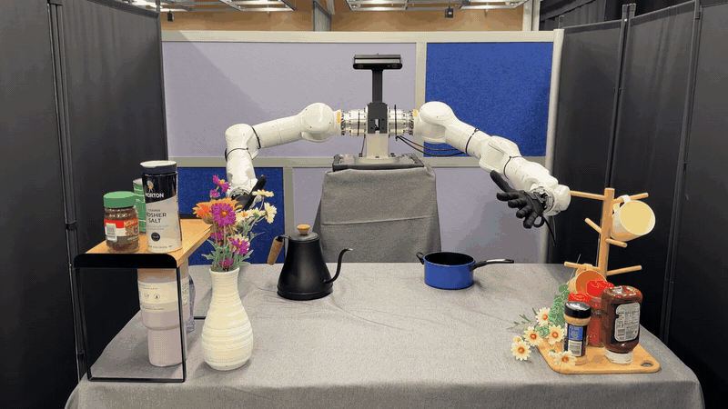

# SpatialDex

### Reconstruction-Augmented Visuomotor Pre-Training of 3D-Grounded Bimanual Dexterity from RGB-Only Human Videos

[Project Page](https://spatial-dex.github.io/) | [Paper](https://arxiv.org/abs/2610.29716)



## Installation

```bash
conda create -n spatialdex python=3.10 -y
conda activate spatialdex
pip install torch==2.5.1 torchvision==0.20.1 --index-url https://download.pytorch.org/whl/cu124
pip install -e .
pip install spconv-cu124 torch-scatter -f https://data.pyg.org/whl/torch-2.5.1+cu124.html
pip install flash-attn --no-build-isolation
```

Install [DexJoCo](https://github.com/jellyho/dexjoco) at commit `c592293`:

```bash
git clone https://github.com/jellyho/dexjoco
cd dexjoco && git checkout c592293 && pip install -e dexjoco --no-deps
```

Download the PaliGemma 2 processor files (accept the Gemma license on Hugging Face first):

```bash
huggingface-cli download google/paligemma2-3b-mix-224 --include "*.json" --local-dir weights/paligemma2-3b-mix-224
```

## Checkpoints

Download the [SpatialDex checkpoints](https://drive.google.com/drive/folders/1RNyjRYEt5H-uJ_gn5VN2EJCad6eFv8Fb?usp=sharing) and place them under `weights/` as shown below.

```
weights/
├── pretrain.safetensors
├── dexjoco/
│   ├── microwave.safetensors
│   ├── assembly.safetensors
│   ├── fold_glasses.safetensors
│   ├── water_plant.safetensors
│   ├── pick_bucket.safetensors
│   └── hammer_nail.safetensors
└── wuji_tianji/
    ├── relocate_ball.safetensors
    ├── relocate_ball.json
    ├── pass_toy.safetensors
    ├── pass_toy.json
    ├── sweep_trash.safetensors
    └── sweep_trash.json
```

## DexJoCo Evaluation

```bash
python -m spatialdex.eval.dexjoco --task microwave --output outputs/microwave
```

`--task` is one of `microwave`, `assembly`, `fold_glasses`, `water_plant`, `pick_bucket` and `hammer_nail`.

## Wuji + Tianji Evaluation

Download the [Wuji + Tianji dataset](https://drive.google.com/drive/folders/1JIuJSCrXiCDoeL8Y6iPGrPxHZdh2-kq8?usp=sharing) and place the task folders under `data/wuji_tianji/` as shown below.

```
data/wuji_tianji/
├── relocate_ball/
│   ├── train/
│   └── eval/
├── pass_toy/
└── sweep_trash/
```

Post-train from the pre-trained checkpoint on 8 GPUs:

```bash
torchrun --nproc_per_node 8 -m spatialdex.train --task sweep_trash --output outputs/sweep_trash
```

Evaluate a checkpoint:

```bash
python -m spatialdex.eval.wuji --task sweep_trash --checkpoint weights/wuji_tianji/sweep_trash.safetensors --output outputs/sweep_trash_eval
```

`--task` is one of `relocate_ball`, `pass_toy` and `sweep_trash`.

## Citation

```bibtex
@misc{he2026spatialdex,
      title={Reconstruction-Augmented Visuomotor Pre-Training of 3D-Grounded Bimanual Dexterity from RGB-Only Human Videos},
      author={Xingyi He and Zhiwen Qiu and Adhitya Polavaram and Yunhao Cao and Cory Fan and Julius Samwer and Saleh Kalantari and Kuan Fang},
      year={2026},
      eprint={2610.29716},
      archivePrefix={arXiv},
      primaryClass={cs.RO},
      url={https://arxiv.org/abs/2610.29716},
}
```

## Acknowledgement

This codebase is largely based on [VITRA](https://github.com/microsoft/VITRA), [Sonata](https://github.com/facebookresearch/sonata) and [PaliGemma 2](https://huggingface.co/google/paligemma2-3b-mix-224). We also use [DINOv2](https://github.com/facebookresearch/dinov2), [DiT](https://github.com/facebookresearch/DiT), [Pi3](https://github.com/yyfz/Pi3) and [DexJoCo](https://github.com/jellyho/dexjoco). We thank the authors for releasing their code.
