<h2 align="center">SpatialDex: Reconstruction-Augmented Visuomotor Pre-Training of 3D-Grounded Bimanual Dexterity from RGB-Only Human Videos</h2>

<p align="center">
  Xingyi He*,
  Zhiwen Qiu*,
  Adhitya Polavaram*,
  Yunhao Cao*,
  Cory Fan,
  Julius Samwer,
  Saleh Kalantari,
  Kuan Fang
  <br>
  <sub>* Equal contribution</sub>
</p>

<p align="center">
  <a href="https://spatial-dex.github.io/">[Project Page]</a>
  <a href="https://arxiv.org/abs/2610.29716">[Paper]</a>
  <a href="#datasets-and-checkpoints">[Datasets]</a>
  <a href="#datasets-and-checkpoints">[Checkpoints]</a>
  <a href="#citation">[Citation]</a>
</p>

SpatialDex is a 3D-grounded visuomotor policy for bimanual dexterous manipulation. It is pre-trained on 1M human-video clips whose scene geometry and hand motion are reconstructed from RGB alone, then adapted to a robot with a small number of teleoperated demonstrations.

<table>
  <tr>
    <td align="center" width="33%">
      <br>
      <b>Unzip Bag</b>
    </td>
    <td align="center" width="33%">
      <br>
      <b>Sweep Trash</b>
    </td>
    <td align="center" width="33%">
      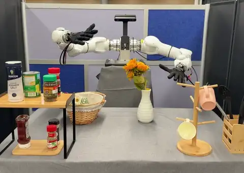<br>
      <b>Pass Flower</b>
    </td>
  </tr>
  <tr>
    <td align="center">
      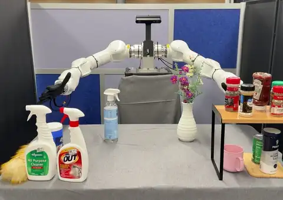<br>
      <b>Spray Plant</b>
    </td>
    <td align="center">
      <br>
      <b>Pack Suitcase</b>
    </td>
    <td align="center">
      <br>
      <b>Pour Water</b>
    </td>
  </tr>
</table>

## Highlights

- **1M human-video clips with aligned scene geometry and hand motion.** We reconstruct depth and camera motion for the clips of VITRA-1M and align them with the hand motion at a shared scale.
- **A 3D-grounded visuomotor policy pre-trained on human videos.** The released checkpoint fine-tunes to bimanual dexterous tasks with a small number of robot demonstrations.
- **43.3% &rarr; 81.7%** success on six real-world bimanual tasks, from the strongest baseline π<sub>0.5</sub> to SpatialDex.
- **59.8% &rarr; 76.3%** success on nine simulated tasks across two embodiments, from the strongest baseline to SpatialDex.
- **58.9% &rarr; 73.1%** success from pre-training on hand motion alone to pre-training with reconstructed geometry.
- **Reusable simulation resources.** The release includes a MuJoCo model of our Wuji + Tianji robot, three tasks, demonstrations, and fine-tuning and evaluation code for experiments without the physical hardware.

## Contents

- [Highlights](#highlights)
- [Method Overview](#method-overview)
- [Installation](#installation)
- [Datasets and Checkpoints](#datasets-and-checkpoints)
- [Fine-Tuning](#fine-tuning)
- [Simulation](#simulation)
  - [Wuji + Tianji](#wuji--tianji)
  - [DexJoCo](#dexjoco)
- [Citation](#citation)

## Method Overview

**Aligned scene and hand reconstruction.** From each RGB-only human video we reconstruct scene geometry and estimate hand motion, then align the two at one shared scale per video using the hand-size prior of the hand estimates. The result supplies depth observations, wrist and finger action targets, and future-geometry targets.


**Reconstructed human videos.** Examples of the reconstructed pre-training data. (Top) Scene geometry, camera, and hand motion recovered from an RGB video, next to the input video with the estimated hands and per-hand instructions. (Bottom) Reconstructed scenes and hand motion from twelve more clips.

<p align="center">
  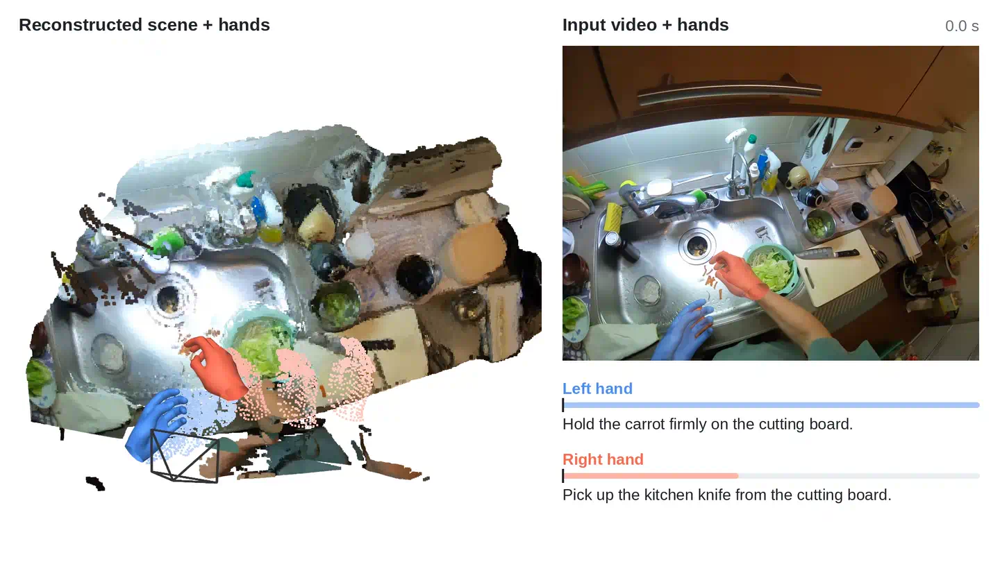
</p>

<p align="center">
  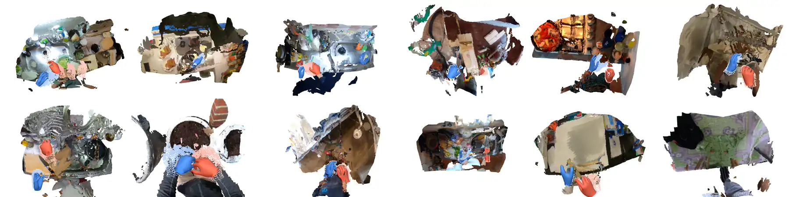
</p>

**3D-grounded policy.** Depth is back-projected to 3D points, encoded as a point cloud, and fused into the visual tokens of a pre-trained VLM with gated residual fusion. A training-only head predicts future geometry. A wrist expert predicts wrist trajectories, and a finger expert predicts finger actions conditioned on them.

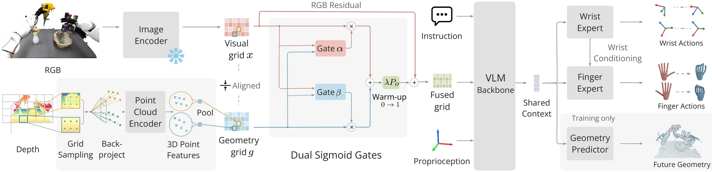

## Installation

Run the commands below from the SpatialDex repository root.

Create the environment and install dependencies:

```bash
conda create -n spatialdex python=3.10 -y
conda activate spatialdex
pip install torch==2.5.1 torchvision==0.20.1 --index-url https://download.pytorch.org/whl/cu124
pip install -e .
pip install spconv-cu124 torch-scatter -f https://data.pyg.org/whl/torch-2.5.1+cu124.html
pip install flash-attn --no-build-isolation
```

Download the PaliGemma 2 processor files after accepting the Gemma license on Hugging Face:

```bash
hf download google/paligemma2-3b-mix-224 --include "*.json" --local-dir weights/paligemma2-3b-mix-224
```

## Datasets and Checkpoints

The pre-trained checkpoint is the starting point for [fine-tuning on robot demonstrations](#fine-tuning). The task checkpoints run the [simulation rollouts](#simulation) directly.

| Setting | Checkpoints | Data |
|---|---|---|
| [Pre-Training](https://huggingface.co/datasets/grillab/spatialdex) | [Link](https://drive.google.com/file/d/1gEAiTJC9Ai1zth0KuCzo0l3-u6q_DnMf/view?usp=sharing) | [Link](https://huggingface.co/datasets/grillab/spatialdex) |
| [Wuji + Tianji](#wuji--tianji) | [Link](https://drive.google.com/drive/folders/1jaWnE7NDfqOGkN1P0sj2ZjoJIOP_UM1A) | [Link](https://drive.google.com/drive/folders/1JIuJSCrXiCDoeL8Y6iPGrPxHZdh2-kq8?usp=sharing) |
| [DexJoCo](#dexjoco) | [Link](https://drive.google.com/drive/folders/1J-OQdDmzku-XGDcYEwXd2C9fM9zbhRRC) | [Link](https://huggingface.co/datasets/DexJoCo/DexJoCo-Datasets-LeRobot) |

Place `pretrain.safetensors` under `weights/`, Wuji + Tianji task checkpoints under `weights/wuji_tianji/`, and DexJoCo task checkpoints under `weights/dexjoco/`.

For each Wuji + Tianji checkpoint, also download the matching `<task>.json` file. It contains the normalization statistics and is loaded automatically from the same directory as the checkpoint.

<details>
<summary>Checkpoint directory layout</summary>

```
weights/
├── pretrain.safetensors
├── wuji_tianji/
│   ├── relocate_ball.safetensors
│   ├── relocate_ball.json
│   ├── pass_toy.safetensors
│   ├── pass_toy.json
│   ├── sweep_trash.safetensors
│   └── sweep_trash.json
└── dexjoco/
    ├── microwave.safetensors
    ├── assembly.safetensors
    ├── fold_glasses.safetensors
    ├── water_plant.safetensors
    ├── pick_bucket.safetensors
    └── hammer_nail.safetensors
```

</details>

Place the Wuji + Tianji dataset's task folders under `data/wuji_tianji/`. Evaluation uses the scenes in `eval/`; fine-tuning uses the demonstrations in `train/`.

```
data/wuji_tianji/
├── relocate_ball/
│   ├── train/
│   └── eval/
├── pass_toy/
└── sweep_trash/
```

## Fine-Tuning

Fine-tuning adapts the human-video pre-trained checkpoint to a target robot with a small number of demonstrations. The released training script covers the three Wuji + Tianji simulation tasks.

Download the pre-trained checkpoint and task dataset from [Datasets and Checkpoints](#datasets-and-checkpoints), placing the checkpoint at `weights/pretrain.safetensors`. The command below uses **8 GPUs** with a batch size of **16 per GPU**:

```bash
torchrun --nproc_per_node 8 -m spatialdex.train --task sweep_trash --output outputs/sweep_trash
```

The provided Wuji + Tianji configurations cover `relocate_ball`, `pass_toy`, and `sweep_trash`. Hyperparameters are in `configs/wuji_tianji/<task>.json`.

This configuration trains for 40,000 steps and saves `step_XXXXXX.safetensors` every 2,500 steps. To evaluate a trained checkpoint, pass its path to `--checkpoint` in the [Wuji + Tianji evaluation command](#wuji--tianji).

## Simulation

Evaluate the released checkpoints on three [Wuji + Tianji](#wuji--tianji) tasks and six [DexJoCo](#dexjoco) tasks. The table compares SpatialDex with π<sub>0.5</sub>, the strongest baseline in our experiments. Success rates (%) are averaged over three seeds, with 50 episodes per seed.

See the [project page](https://spatial-dex.github.io/) for real-robot results, all baselines, and ablations.

| Environment | Task | `--task` | π<sub>0.5</sub> | SpatialDex |
|---|---|---|---:|---:|
| [Wuji + Tianji](#wuji--tianji) | Relocate Ball | `relocate_ball` | 64.7 | **88.7** |
| | Pass Toy | `pass_toy` | 36.0 | **75.3** |
| | Sweep Trash | `sweep_trash` | 32.7 | **80.0** |
| [DexJoCo](#dexjoco) | Fold Glasses | `fold_glasses` | 72.0 | **77.3** |
| | Hammer Nail | `hammer_nail` | 84.7 | **94.0** |
| | Water Plant | `water_plant` | 88.7 | **91.3** |
| | Pick Bucket | `pick_bucket` | **84.0** | 79.3 |
| | Bimanual Assembly | `assembly` | 5.3 | **16.7** |
| | Bimanual Microwave | `microwave` | 70.0 | **84.0** |

### Wuji + Tianji

<table>
  <tr>
    <td align="center" width="33%">
      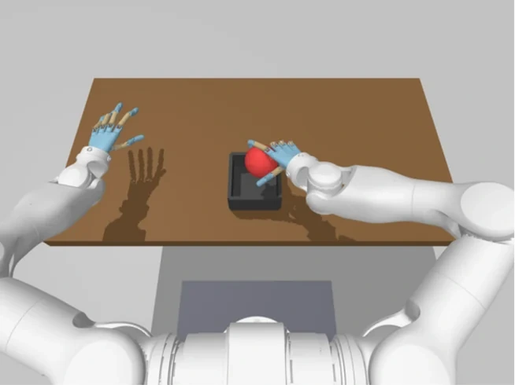<br>
      <b>Relocate Ball</b>
    </td>
    <td align="center" width="33%">
      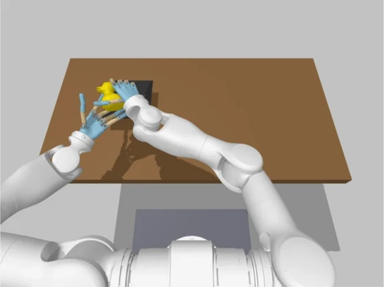<br>
      <b>Pass Toy</b>
    </td>
    <td align="center" width="33%">
      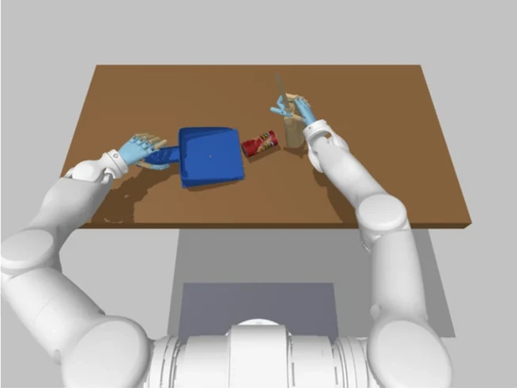<br>
      <b>Sweep Trash</b>
    </td>
  </tr>
</table>

These three tasks use two 7-DoF Tianji arms with 20-DoF Wuji hands in MuJoCo, matching our real-robot setup. Observations come from one head RGB-D camera.

**Setup**

Download the task checkpoints, matching normalization statistics, and dataset from [Datasets and Checkpoints](#datasets-and-checkpoints). On a headless machine, set `MUJOCO_GL=egl` before evaluation.

**Evaluation**

```bash
python -m spatialdex.eval.wuji --task sweep_trash --checkpoint weights/wuji_tianji/sweep_trash.safetensors --output outputs/sweep_trash_eval
```

`--task` accepts `relocate_ball`, `pass_toy`, or `sweep_trash`. Evaluation runs every scene in `data/wuji_tianji/<task>/eval/` by default. It writes results to `results.json` and saves one rollout video per episode in the output directory.

**Options**

- `--episodes`: run selected episode numbers.
- `--no_video`: skip video recording.

<details>
<summary>Task instructions and success criteria</summary>

| Task | Active hands | Instruction (per hand) | Success criterion |
|---|---|---|---|
| `relocate_ball` | left, right, or both, set per episode | "Pick up the red ball and place it in the gray box-shaped container" | ball is inside the container |
| `pass_toy` | both | "Pick up the {object} and hand it off to the other hand" / "Receive the {object} from the other hand and place it in the gray box-shaped container" | object is inside the container |
| `sweep_trash` | both | "Use broom to sweep the {object} into the dustpan" / "Hold the dustpan to receive the {object}" | object is on the dustpan |

`{object}` is a yellow duck or a red Pringles can. Which hand takes which role varies between episodes.

</details>

### DexJoCo

<table>
  <tr>
    <td align="center" width="33%">
      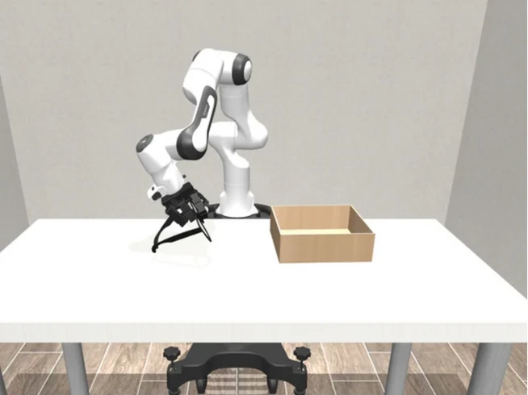<br>
      <b>Fold Glasses</b>
    </td>
    <td align="center" width="33%">
      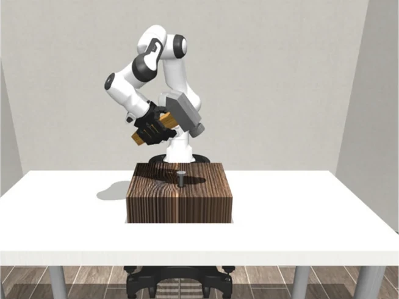<br>
      <b>Hammer Nail</b>
    </td>
    <td align="center" width="33%">
      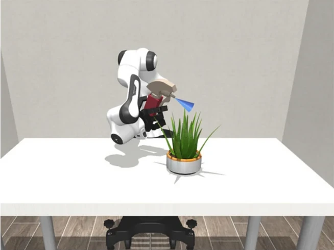<br>
      <b>Water Plant</b>
    </td>
  </tr>
  <tr>
    <td align="center" width="33%">
      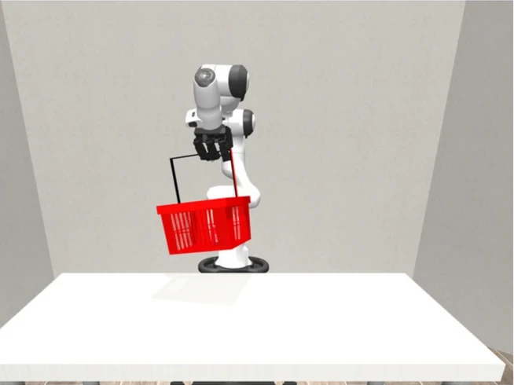<br>
      <b>Pick Bucket</b>
    </td>
    <td align="center" width="33%">
      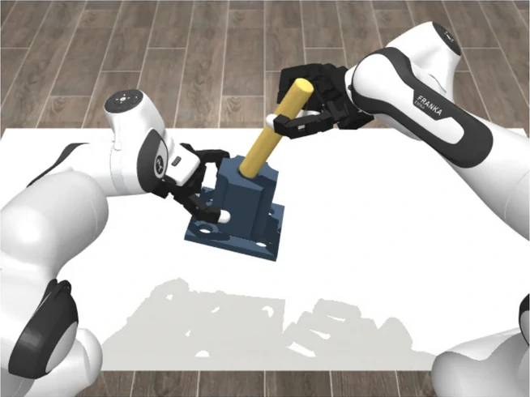<br>
      <b>Bimanual Assembly</b>
    </td>
    <td align="center" width="33%">
      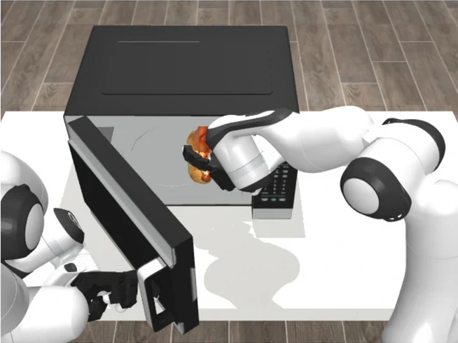<br>
      <b>Bimanual Microwave</b>
    </td>
  </tr>
</table>

These six tasks use Allegro hands on Franka arms in [DexJoCo](https://github.com/jellyho/dexjoco).

**Setup**

Download the task checkpoints from [Datasets and Checkpoints](#datasets-and-checkpoints) and install DexJoCo at commit `c592293`:

```bash
git clone https://github.com/jellyho/dexjoco
(
  cd dexjoco &&
  git checkout c592293 &&
  pip install -e dexjoco --no-deps
)
```

**Evaluation**

```bash
python -m spatialdex.eval.dexjoco --task microwave --output outputs/microwave
```

`--task` accepts `microwave`, `assembly`, `fold_glasses`, `water_plant`, `pick_bucket`, or `hammer_nail`. The checkpoint defaults to `weights/dexjoco/<task>.safetensors`. Evaluation runs 50 episodes by default. It writes results to `results.json` and saves one rollout video per episode in the output directory.

**Options**

- `--episodes`: set the number of evaluation episodes.
- `--seed`: set the starting seed.
- `--no-video`: skip video recording.

## Citation

If you use SpatialDex, the released checkpoints, the dataset, or the Wuji + Tianji simulation resources in your research, please cite our paper. If you use the dataset, please also cite VITRA and VGGT-Ω, which provide its hand annotations and its depth and camera estimates.

```bibtex
@misc{he2026spatialdex,
      title={Reconstruction-Augmented Visuomotor Pre-Training of 3D-Grounded Bimanual Dexterity from RGB-Only Human Videos},
      author={Xingyi He and Zhiwen Qiu and Adhitya Polavaram and Yunhao Cao and Cory Fan and Julius Samwer and Saleh Kalantari and Kuan Fang},
      year={2026},
      eprint={2610.29716},
      archivePrefix={arXiv},
      primaryClass={cs.RO},
      url={https://arxiv.org/abs/2610.29716},
}
```

## License

The code is released under the [MIT License](LICENSE). Third-party components keep their own licenses, which are listed in [NOTICE](NOTICE), and some of them are limited to non-commercial use. The released checkpoints are initialized from PaliGemma 2 and are subject to the Gemma Terms of Use. The [SpatialDex dataset](https://huggingface.co/datasets/grillab/spatialdex) is released under CC BY-NC 4.0 for non-commercial research.
