<h1 align="center">SpatialDex</h1>

<p align="center">
  <b>Reconstruction-Augmented Visuomotor Pre-Training of 3D-Grounded Bimanual Dexterity from RGB-Only Human Videos</b>
</p>

<p align="center">
  Xingyi He*, Zhiwen Qiu*, Adhitya Polavaram*, Yunhao Cao*, Cory Fan, Julius Samwer, Saleh Kalantari, Kuan Fang
  <br>
  <sub>* Equal contribution</sub>
</p>

<p align="center">
  <a href="https://spatial-dex.github.io/"></a>
  <a href="https://arxiv.org/abs/2610.29716"></a>
  <a href="https://spatial-dex.github.io/#video"></a>
  <a href="#checkpoints"></a>
  
  <a href="LICENSE"></a>
</p>

SpatialDex is a 3D-grounded visuomotor policy for bimanual dexterous hands. It is pre-trained on 1M human-video clips whose scene geometry and hand motion are reconstructed from RGB alone, then adapted to a robot with a small number of teleoperated demonstrations.

<table>
  <tr>
    <td align="center" width="33%">
      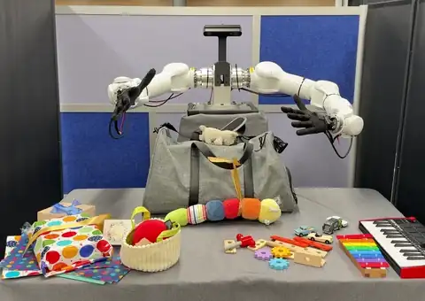<br>
      <b>Unzip Bag</b>
    </td>
    <td align="center" width="33%">
      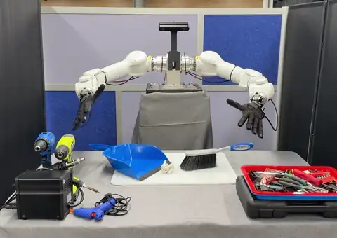<br>
      <b>Sweep Trash</b>
    </td>
    <td align="center" width="33%">
      <br>
      <b>Pass Flower</b>
    </td>
  </tr>
  <tr>
    <td align="center">
      <br>
      <b>Spray Plant</b>
    </td>
    <td align="center">
      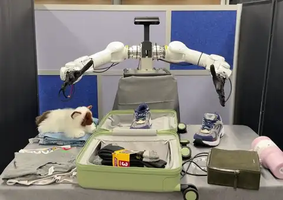<br>
      <b>Pack Suitcase</b>
    </td>
    <td align="center">
      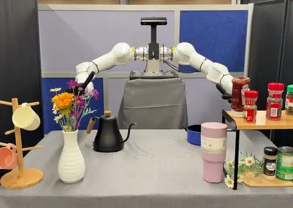<br>
      <b>Pour Water</b>
    </td>
  </tr>
</table>


## Highlights

- **Real robot:** 81.7% success over six bimanual dexterous tasks, against 43.3% for the strongest baseline (π<sub>0.5</sub>).
- **Simulation:** 76.3% mean success over nine tasks on two embodiments, against 59.8% for the strongest baseline.
- **Why geometry matters:** on the same videos, demonstrations and budget, pre-training with reconstructed geometry reaches 73.1%, against 58.9% for pre-training on hand motion alone.
- **Wuji + Tianji simulation:** this repository includes a MuJoCo model of our bimanual robot, three tasks, demonstrations, and the post-training and evaluation code, so the Wuji + Tianji simulation results can be reproduced without the hardware.

## How it works

**1. Aligned scene and hand reconstruction.** From each RGB-only human video we reconstruct scene geometry and estimate hand motion, then align the two at one shared scale per video using the hand-size prior of the hand estimates. The result supplies depth observations, wrist and finger action targets, and future-geometry targets.

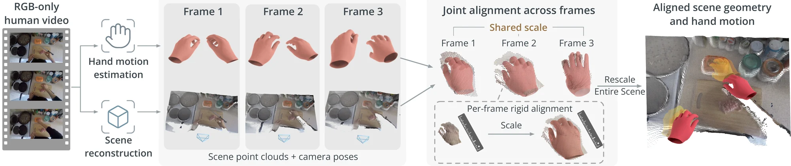

**2. 3D-grounded policy.** Depth is back-projected to 3D points, encoded with a point-cloud encoder, and fused into the visual token grid of a pre-trained VLM through gated residual fusion. A training-only head predicts future scene geometry. A wrist expert predicts both wrist trajectories, and a finger expert predicts finger actions conditioned on them.


## Wuji + Tianji simulation

The simulated robot is the same embodiment as the real robot in the clips above: two 7-DoF Tianji arms, each carrying a 20-DoF Wuji hand, observed by one head RGB-D camera. It runs in MuJoCo.

<table>
  <tr>
    <td align="center" width="33%">
      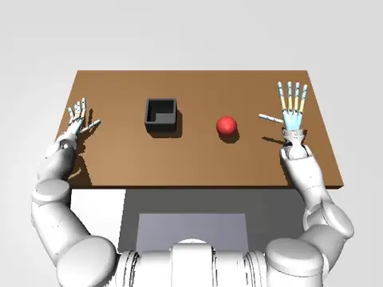<br>
      <b>Relocate Ball</b><br><code>relocate_ball</code>
    </td>
    <td align="center" width="33%">
      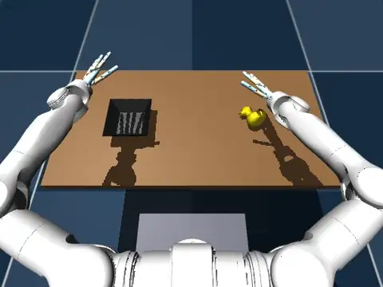<br>
      <b>Pass Toy</b><br><code>pass_toy</code>
    </td>
    <td align="center" width="33%">
      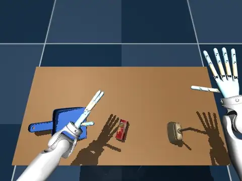<br>
      <b>Sweep Trash</b><br><code>sweep_trash</code>
    </td>
  </tr>
</table>

| Task | Active hands | Instruction (per hand) | Success |
|---|---|---|---|
| `relocate_ball` | left, right or both, set per episode | "Pick up the red ball and place it in the gray box-shaped container" | ball is inside the container |
| `pass_toy` | both | "Pick up the {object} and hand it off to the other hand" / "Receive the {object} from the other hand and place it in the gray box-shaped container" | object is inside the container |
| `sweep_trash` | both | "Use broom to sweep the {object} into the dustpan" / "Hold the dustpan to receive the {object}" | object is on the dustpan |

`{object}` is a yellow duck or a red Pringles can. Which hand takes which role varies between episodes.

## Installation

```bash
conda create -n spatialdex python=3.10 -y
conda activate spatialdex
pip install torch==2.5.1 torchvision==0.20.1 --index-url https://download.pytorch.org/whl/cu124
pip install -e .
pip install spconv-cu124 torch-scatter -f https://data.pyg.org/whl/torch-2.5.1+cu124.html
pip install flash-attn --no-build-isolation
```

Install [DexJoCo](https://github.com/jellyho/dexjoco) at commit `c592293` (only needed for the DexJoCo evaluation):

```bash
git clone https://github.com/jellyho/dexjoco
cd dexjoco && git checkout c592293 && pip install -e dexjoco --no-deps
```

Download the PaliGemma 2 processor files (accept the Gemma license on Hugging Face first):

```bash
huggingface-cli download google/paligemma2-3b-mix-224 --include "*.json" --local-dir weights/paligemma2-3b-mix-224
```

## Checkpoints

Download the [SpatialDex checkpoints](https://drive.google.com/drive/folders/1RNyjRYEt5H-uJ_gn5VN2EJCad6eFv8Fb?usp=sharing) and place them under `weights/`.

| Checkpoint | Stage | Embodiment | Use it to |
|---|---|---|---|
| `pretrain.safetensors` | pre-trained on human videos | human hands | post-train on robot demonstrations |
| `dexjoco/<task>.safetensors` | post-trained, one per task | Allegro hands on Franka arms | reproduce the DexJoCo results |
| `wuji_tianji/<task>.safetensors` | post-trained, one per task | Wuji hands on Tianji arms | reproduce the Wuji + Tianji results |

```
weights/
├── pretrain.safetensors
├── dexjoco/
│   ├── microwave.safetensors
│   ├── assembly.safetensors
│   ├── fold_glasses.safetensors
│   ├── water_plant.safetensors
│   ├── pick_bucket.safetensors
│   └── hammer_nail.safetensors
└── wuji_tianji/
    ├── relocate_ball.safetensors
    ├── relocate_ball.json
    ├── pass_toy.safetensors
    ├── pass_toy.json
    ├── sweep_trash.safetensors
    └── sweep_trash.json
```

Each `wuji_tianji/<task>.json` holds the normalization statistics for the checkpoint next to it and is picked up automatically.

## DexJoCo evaluation

<table>
  <tr>
    <td align="center" width="33%">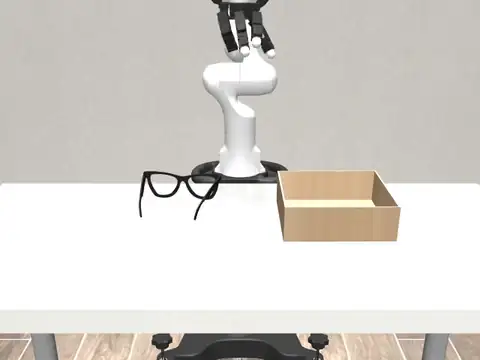<br><code>fold_glasses</code></td>
    <td align="center" width="33%">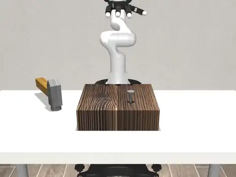<br><code>hammer_nail</code></td>
    <td align="center" width="33%">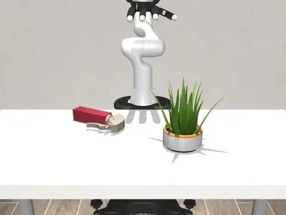<br><code>water_plant</code></td>
  </tr>
  <tr>
    <td align="center">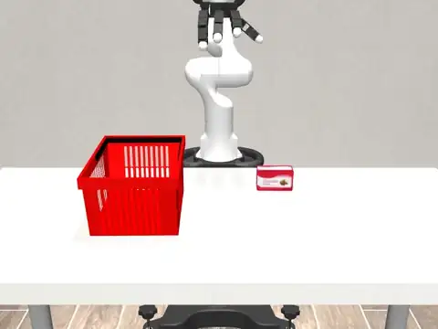<br><code>pick_bucket</code></td>
    <td align="center">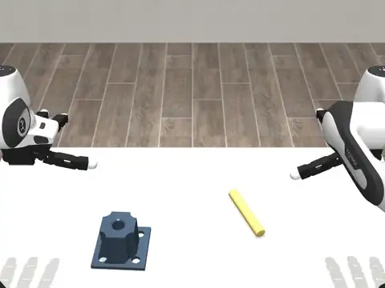<br><code>assembly</code> (bimanual)</td>
    <td align="center">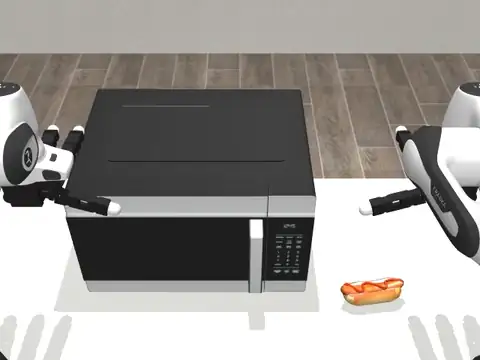<br><code>microwave</code> (bimanual)</td>
  </tr>
</table>

```bash
python -m spatialdex.eval.dexjoco --task microwave --output outputs/microwave
```

`--task` is one of `microwave`, `assembly`, `fold_glasses`, `water_plant`, `pick_bucket` and `hammer_nail`. The checkpoint defaults to `weights/dexjoco/<task>.safetensors`.

The run evaluates 50 episodes and writes `results.json` (success rate and per-episode outcomes) and one video per episode to the output folder. Use `--episodes` and `--seed` to change the episode count and the starting seed, and `--no-video` to skip the videos.

## Wuji + Tianji post-training and evaluation

Download the [Wuji + Tianji dataset](https://drive.google.com/drive/folders/1JIuJSCrXiCDoeL8Y6iPGrPxHZdh2-kq8?usp=sharing) and place the task folders under `data/wuji_tianji/`.

```
data/wuji_tianji/
├── relocate_ball/
│   ├── train/
│   └── eval/
├── pass_toy/
└── sweep_trash/
```

**Evaluate** a released checkpoint:

```bash
python -m spatialdex.eval.wuji --task sweep_trash --checkpoint weights/wuji_tianji/sweep_trash.safetensors --output outputs/sweep_trash_eval
```

`--task` is one of `relocate_ball`, `pass_toy` and `sweep_trash`. The run rolls out every scene in `data/wuji_tianji/<task>/eval/` and writes `results.json` and one video per episode. Pass episode numbers to `--episodes` to run selected scenes and `--no_video` to skip the videos. On a headless machine, set `MUJOCO_GL=egl`.

**Post-train** from the pre-trained checkpoint on 8 GPUs:

```bash
torchrun --nproc_per_node 8 -m spatialdex.train --task sweep_trash --output outputs/sweep_trash
```

Training runs for 40,000 steps with a batch size of 16 per GPU and saves `step_XXXXXX.safetensors` every 2,500 steps. Hyperparameters are in `configs/wuji_tianji/<task>.json`. To evaluate your own checkpoint, pass it to `--checkpoint` as above.

## Expected results

Simulation success rates in %, as means over three seeds with 50 episodes per seed. π<sub>0.5</sub> is the strongest of eleven baselines. Real-robot results, all baselines and ablations are on the [project page](https://spatial-dex.github.io/).

| Embodiment | Task | `--task` | π<sub>0.5</sub> | SpatialDex |
|---|---|---|---:|---:|
| Allegro + Franka | Fold Glasses | `fold_glasses` | 72.0 | **77.3** |
| | Hammer Nail | `hammer_nail` | 84.7 | **94.0** |
| | Water Plant | `water_plant` | 88.7 | **91.3** |
| | Pick Bucket | `pick_bucket` | **84.0** | 79.3 |
| | Bimanual Assembly | `assembly` | 5.3 | **16.7** |
| | Bimanual Microwave | `microwave` | 70.0 | **84.0** |
| Wuji + Tianji | Relocate Ball | `relocate_ball` | 64.7 | **88.7** |
| | Pass Toy | `pass_toy` | 36.0 | **75.3** |
| | Sweep Trash | `sweep_trash` | 32.7 | **80.0** |
| | **Mean over nine tasks** | | 59.8 | **76.3** |

## Citation

```bibtex
@misc{he2026spatialdex,
      title={Reconstruction-Augmented Visuomotor Pre-Training of 3D-Grounded Bimanual Dexterity from RGB-Only Human Videos},
      author={Xingyi He and Zhiwen Qiu and Adhitya Polavaram and Yunhao Cao and Cory Fan and Julius Samwer and Saleh Kalantari and Kuan Fang},
      year={2026},
      eprint={2610.29716},
      archivePrefix={arXiv},
      primaryClass={cs.RO},
      url={https://arxiv.org/abs/2610.29716},
}
```

## License

The code is released under the [MIT License](LICENSE). Some components are adapted from projects with other licenses, and the released weights are fine-tuned from PaliGemma 2 and are subject to the Gemma Terms of Use. See [NOTICE](NOTICE) for details.

## Acknowledgement

This codebase is largely based on [VITRA](https://github.com/microsoft/VITRA), [Sonata](https://github.com/facebookresearch/sonata) and [PaliGemma 2](https://huggingface.co/google/paligemma2-3b-mix-224). We also use [DINOv2](https://github.com/facebookresearch/dinov2), [DiT](https://github.com/facebookresearch/DiT), [Pi3](https://github.com/yyfz/Pi3) and [DexJoCo](https://github.com/jellyho/dexjoco). We thank the authors for releasing their code.
